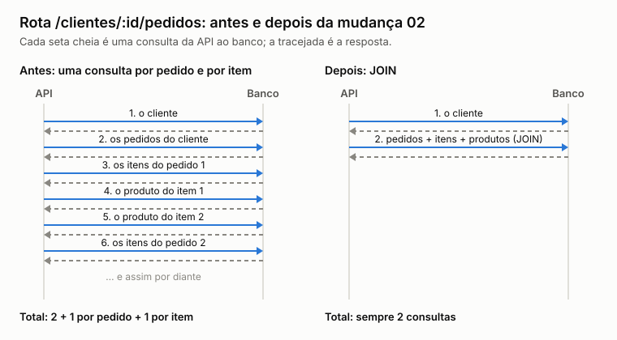
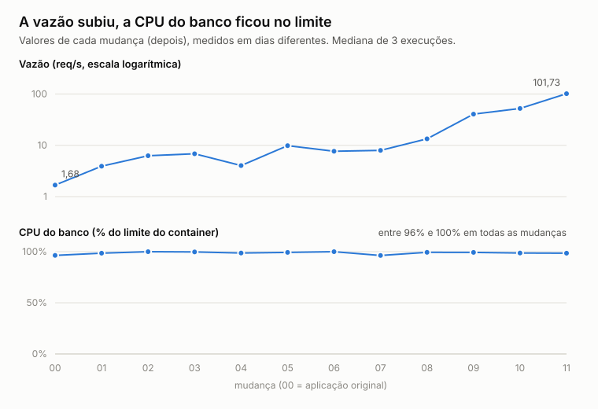
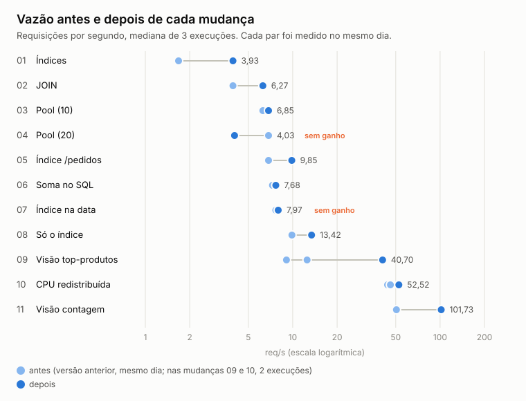

# Como uma API de loja passou a atender mais de 60 vezes mais requisições por segundo

## 1. Resumo

A aplicação é a API de uma loja fictícia, que ficava muito lenta sob carga. Medi a versão original, achei rotas lendo tabelas inteiras e fiz 11 mudanças, medindo cada uma: índices, resultados guardados prontos, pool de conexões, trabalho passado da API para o banco e CPU redistribuída, sem aumentar o total. A vazão foi de 1,68 para 101,73 requisições por segundo, e o p95 de 41966,6 para 440,3 ms, com as mesmas respostas. Os maiores saltos vieram dos resultados guardados prontos. Duas mudanças não deram ganho: o pool com 20 conexões e o índice na data dos pedidos.

## 2. Contexto e diagnóstico

Na linha de base, o banco usava 96,4% da CPU, e a API só 9,3% ([medianas da linha de base](../medianas-linha-de-base.txt)), então concentrei a investigação no banco. As rotas mais lentas eram `pedidos-do-cliente` (35613,7 ms de mediana), `top-produtos` (27212,7 ms) e `pedidos-por-status` (12314,9 ms) ([linha de base](../resultados/20261104-171309-00-linha-de-base/resumo.txt)).

**Tabelas lidas inteiras.** O `EXPLAIN ANALYZE`, que mostra como o banco executa uma consulta, revelou várias leituras de tabelas inteiras (Seq Scan), de até 1,5 milhão de linhas, para devolver poucas ([diagnósticos 01 a 07](../diagnostico-bd/)). Só havia índices nas chaves primárias ([diagnóstico 08](../diagnostico-bd/08-indices.txt)). Hipótese: faltam índices nas colunas filtradas.

**Conexão nova a cada consulta.** Pelo que estudei na faculdade, abrir conexões custa caro, e a documentação do `pg`, biblioteca usada pela API, confirma: cada conexão nova leva de 20 a 30 ms ([node-postgres](https://node-postgres.com/features/pooling)). Na API, era uma conexão por consulta. Para medir, usei o `pgbench`, que vi em [Freund (2020)](https://techcommunity.microsoft.com/blog/adforpostgresql/analyzing-the-limits-of-connection-scalability-in-postgres/1757266), com a opção `-C`, indicada pela [documentação](https://www.postgresql.org/docs/16/pgbench.html) para isso: 1631 consultas por segundo reaproveitando a conexão, contra 113 reconectando ([diagnóstico da API](../diagnostico-api/01-custo-conexao-pgbench.txt)). Hipótese: abrir conexões gasta CPU à toa.

**Trabalho no lugar errado.** `/clientes/:id/pedidos` fazia uma consulta para cada pedido e outra para cada item, e `vendas-por-dia` trazia 12945 linhas para somar em JavaScript ([diagnóstico 10](../diagnostico-bd/10-explain-vendas-por-dia-atual.txt)). Hipótese: idas e voltas demais ao banco e somas fora dele deixam as rotas lentas.

**Contas refeitas.** A `top-produtos` somava 1,5 milhão de itens a cada chamada: 3271,8 ms só a consulta ([diagnóstico 07](../diagnostico-bd/07-explain-top-produtos.txt)). Hipótese: refazer essa soma pesada toda vez ocupa o banco por segundos.

## 3. Estado da arte

### Índices

Um índice é parecido com o índice remissivo de um livro: procura-se o termo e vai-se direto à página, sem ler tudo. Comparação da própria [documentação do PostgreSQL](https://www.postgresql.org/docs/16/indexes-intro.html). Sem índice, o banco lê a tabela inteira (Seq Scan), custo que [Cárdenas (1975)](https://doi.org/10.1145/360762.360766) já modelava. Com `ORDER BY` e `LIMIT`, como o índice está em ordem, o banco lê só as linhas pedidas, "without scanning the remainder at all" ([PostgreSQL](https://www.postgresql.org/docs/16/indexes-ordering.html)). O custo é que o índice "adds overhead to data manipulation operations", ou seja, as escritas ficam mais lentas.

### Menos consultas e trabalho no banco

Buscar dados encadeados, como os pedidos de um cliente e depois os itens de cada pedido, gera uma consulta por item: é o problema N+1, uma consulta para a lista e mais N ([Wellhausen, 2008](https://www.tim-wellhausen.de/papers/ObjectPrefetchFilter/ObjectPrefetchFilter.html)). Com cada consulta a 1–2 ms, 100 delas somam 100–200 ms ([Phabricator](https://secure.phabricator.com/book/phabcontrib/article/n_plus_one/)). [Kossmann (2000)](https://doi.org/10.1145/371578.371598) pesa os dois lados: levar dados sem filtro à aplicação gera "very high communication costs", mas processar tudo no servidor pode sobrecarregá-lo. Na minha leitura, somar no banco compensa quando a aplicação receberia muitas linhas para devolver poucas, mas não achei fonte que meça isso.

### Pool de conexões

Cada conexão nova custa "TLS, latency, and Postgres costs" ([Freund, 2020](https://techcommunity.microsoft.com/blog/adforpostgresql/analyzing-the-limits-of-connection-scalability-in-postgres/1757266)), e a biblioteca `pg` estima de 20 a 30 ms ([node-postgres](https://node-postgres.com/features/pooling)). O pool mantém uma reserva de conexões abertas: cada consulta pega uma emprestada e a devolve. [Măciucă et al. (2013)](https://scientificbulletin.upb.ro/static/pdfs/rez3bb_114891.pdf) mediram, com 20 usuários por 60 s, 73 requisições bem-sucedidas sem pool contra 301 com pool, numa execução só e em MySQL. [Sobri et al. (2022)](https://doi.org/10.24191/jeesr.v20i1.004) testaram pools de 1, 5 e 10 conexões: o tamanho certo "requires performance testing".

### Resultados guardados prontos

Uma visão materializada é como uma foto de uma consulta, guardada como tabela: o banco lê o resultado em vez de refazer a conta. Para Silberschatz et al. (2006, p. 398), "em muitos casos, é muito menos dispendioso ler o conteúdo de uma view materializada do que calcular" de novo, e o exemplo do livro, uma soma por grupo pedida com frequência, lembra a rota `top-produtos`. Mas a foto fica velha quando os dados mudam: no PostgreSQL, ela só é atualizada com `REFRESH` ([documentação](https://www.postgresql.org/docs/16/rules-materializedviews.html)).

## 4. Alternativas consideradas

| Alternativa | Custo | Desempenho | Risco | Esforço |
|---|---|---|---|---|
| Otimizar consultas (`JOIN` e soma no banco) | Nenhum recurso a mais | Rotas alteradas bem mais rápidas (02 e 06) | Mudar a resposta da rota, o que o contrato confere | Médio: analisar a consulta de cada rota |
| Índices nas colunas filtradas | Só espaço em disco | Ganho em 01, 05 e 08; nenhum em 07 | Escritas mais lentas | Médio |
| Pool de conexões | Nenhum recurso a mais | Ganho com 10 conexões (03); pior com 20 (04) | Escolher o tamanho errado | Muito baixo: um arquivo |
| Visões materializadas | Pouco espaço em disco | O maior ganho (09 e 11) | Resultado desatualizado sem `REFRESH` | Baixo |
| Mais CPU ou memória para o banco | Alto: mais máquina, mais dinheiro | Provável ganho, não medido | Pagar mais pelo mesmo trabalho | Muito baixo: mudar um número |

Considerei cinco alternativas. Otimizar as consultas e criar índices nas colunas filtradas não custam recurso a mais, só a análise de cada rota e um pouco de disco, e evitam que o banco faça buscas desnecessárias. O risco dos índices é deixar as escritas mais lentas; a carga deste teste só faz leituras, então esse risco não aparece aqui, mas apareceria numa loja real. O pool de conexões também não custa recurso e deu pouco trabalho; o risco é escolher o tamanho errado, e foi o que aconteceu: comecei com 10 conexões, testei 20, o resultado piorou, e voltei para 10. As visões materializadas fizeram sentido porque algumas consultas refaziam operações pesadas a cada chamada. Como a carga não altera dados, o resultado guardado não fica velho durante o teste, mas numa loja real precisaria ser atualizado. Aumentar a CPU ou a memória do banco provavelmente traria ganho, mas custa mais máquina, ou seja, mais dinheiro. Por isso, achei que não valeria a pena e descartei.

## 5. Solução escolhida e por quê

Escolhi diminuir o trabalho do banco, sem dar mais CPU nem memória a ele. O banco era o gargalo: usava quase toda a sua CPU, enquanto a API usava perto de 10%. Para isso, criei índices, otimizei consultas, usei um pool de conexões, criei visões materializadas e passei para o banco parte da CPU que a API não usava.

No início, eu queria diminuir o uso de CPU do banco, mas ele continuou sempre perto do máximo. Como a carga não tem pausa, quando o banco faz menos trabalho por requisição, ele usa o tempo que sobrou para atender mais requisições. Por isso, a vazão virou minha principal medida: ela foi de 1,68 para 101,73 requisições por segundo, mais de 60 vezes.

Acredito que aumentar a CPU também ajudaria, mas, sem conhecer o orçamento da loja, não sei se o gasto compensaria. O pool com 20 conexões piorou, e voltei para 10. O índice na data não melhorou a rota sob carga, mas o mantive porque a consulta sozinha ficou mais rápida. Ajustar parâmetros do PostgreSQL, um índice no nome dos produtos e um índice na visão da `top-produtos` ficaram como [testes futuros](../proximos-testes.md).

## 6. Experimento e resultado

Os gráficos são gerados por [`img/gerar_graficos.py`](img/gerar_graficos.py), que lê os números de `resultados/`.

Mudanças 09 e 10: o antes tem 2 execuções do mesmo dia, e as duas aparecem. CPU em % de 1 CPU; memória média do banco.

| Mudança | Hipótese | p95 antes → depois (ms) | req/s antes → depois | CPU/memória | Pastas de resultados | Conclusão |
|---|---|---|---|---|---|---|
| 01 Índices nas colunas filtradas (antes: linha de base) | Índices reduzem o tempo das consultas e a CPU do banco | 41966,6 → 16433,0 | 1,68 → 3,93 | Banco: 96,4% → 98,5%; 399,9 → 398,8 MiB | [024453](../resultados/20261109-024453-01-indices/resumo.txt), [024643](../resultados/20261109-024643-01-indices/resumo.txt), [024823](../resultados/20261109-024823-01-indices/resumo.txt) | Vazão e p95 melhoraram; a CPU não caiu, porque a carga não tem pausa |
| 02 `JOIN` em `/clientes/:id/pedidos` (antes: 01) | Menos consultas deixam a rota mais rápida | 16433,0 → 16796,6 | 3,93 → 6,27 | Banco: 98,5% → 100,1%; 398,8 → 403,5 MiB | [162701](../resultados/20261109-162701-02-join/resumo.txt), [162849](../resultados/20261109-162849-02-join/resumo.txt), [163030](../resultados/20261109-163030-02-join/resumo.txt) | A rota foi de 7390,8 para 598,5 ms; o p95 geral não mudou, porque vinha de outras rotas |
| 03 Pool com 10 conexões (antes: 02) | Reaproveitar conexões reduz o tempo e aumenta a vazão | 16796,6 → 8820,5 | 6,27 → 6,85 | Banco: 100,1% → 99,8%; 403,5 → 402,8 MiB | [165605](../resultados/20261109-165605-03-pool/resumo.txt), [165747](../resultados/20261109-165747-03-pool/resumo.txt), [165931](../resultados/20261109-165931-03-pool/resumo.txt) | p95 e vazão melhoraram, mas a mediana piorou |
| 04 Pool com 20 conexões (antes: 03) | Com 20 conexões, as consultas leves param de esperar na fila | 8820,5 → 24147,3 | 6,85 → 4,03 | Banco: 99,8% → 98,7%; 402,8 → 402,5 MiB | [171132](../resultados/20261109-171132-04-pool-max20/resumo.txt), [171328](../resultados/20261109-171328-04-pool-max20/resumo.txt), [171524](../resultados/20261109-171524-04-pool-max20/resumo.txt) | **Aplicada, sem ganho**: a mediana melhorou, mas p95 e vazão pioraram; voltei para 10 |
| 05 Índice em `(status, criado_em, id)` (antes: 03) | O índice reduz o tempo do `/pedidos` | 8820,5 → 7682,8 | 6,85 → 9,85 | Banco: 99,8% → 99,3%; 402,8 → 429,7 MiB | [010746](../resultados/20261110-010746-05-indice-pedidos/resumo.txt), [010928](../resultados/20261110-010928-05-indice-pedidos/resumo.txt), [011113](../resultados/20261110-011113-05-indice-pedidos/resumo.txt) | A rota foi de 5637,4 para 1711,9 ms |
| 06 `vendas-por-dia` somando no SQL (antes: 05, na mesma ronda) | Somar no banco reduz o tempo da rota | 13428,9 → 8593,3 | 7,29 → 7,68 | Banco: 100,2% → 100,2%; 425,8 → 406,4 MiB; API: 21,4% → 4,6% | [025242](../resultados/20261110-025242-06-intercalado/resumo.txt), [025701](../resultados/20261110-025701-06-intercalado/resumo.txt), [030119](../resultados/20261110-030119-06-intercalado/resumo.txt) | A rota foi de 6283,1 para 2610,4 ms; a vazão ficou no ruído |
| 07 Índice na data de `criado_em` (antes: 06, em outro dia) | O índice deixa a `vendas-por-dia` mais rápida | 8593,3 → 8231,3 | 7,68 → 7,97 | Banco: 100,2% → 96,3%; 406,4 → 410,3 MiB | [181625](../resultados/20261110-181625-07-indice-data/resumo.txt), [181810](../resultados/20261110-181810-07-indice-data/resumo.txt), [181956](../resultados/20261110-181956-07-indice-data/resumo.txt) | **Aplicada, sem ganho**: a consulta sozinha foi de 393,8 para 18,7 ms, mas a rota não melhorou sob carga |
| 08 `/pedidos` lendo só o índice (antes: 07, na mesma ronda) | O banco passa menos tempo na rota e pode usar menos CPU | 9478,4 → 4259,7 | 9,88 → 13,42 | Banco: 97,9% → 99,4%; 411,2 → 410,7 MiB | [214706](../resultados/20261111-214706-08-intercalado/resumo.txt), [215347](../resultados/20261111-215347-08-intercalado/resumo.txt), [220043](../resultados/20261111-220043-08-intercalado/resumo.txt) | A rota foi de 2140,0 para 1199,9 ms; a CPU do banco não caiu |
| 09 `top-produtos` com visão materializada (antes: 08, mesmo dia) | O tempo da rota, o p95 e o p99 caem | 5288,4 e 6652,4 → 1125,8 | 12,52 e 9,07 → 40,70 | Banco: 95,6% e 96,0% → 99,3%; 411,6 e 408,8 → 481,7 MiB | [014420](../resultados/20261112-014420-09-visao-materializada/resumo.txt), [014544](../resultados/20261112-014544-09-visao-materializada/resumo.txt), [014711](../resultados/20261112-014711-09-visao-materializada/resumo.txt) | A rota foi de 19487,5 e 27127,6 para 298,2 ms; a memória do banco ficou perto do limite |
| 10 CPU redistribuída: banco 1,2 e API 0,3 (antes: 09, mesmo dia) | A mediana e o p95 caem | 1081,3 e 1090,8 → 897,3 | 44,02 e 45,99 → 52,52 | Banco: 99,3% e 93,4% → 118,4%; 445,4 e 485,2 → 185,1 MiB | [213149](../resultados/20261113-213149-10-cpu-redistribuida/resumo.txt), [213316](../resultados/20261113-213316-10-cpu-redistribuida/resumo.txt), [213446](../resultados/20261113-213446-10-cpu-redistribuida/resumo.txt) | Vazão e p95 melhoraram; a CPU por requisição não mudou; a API ficou com menos folga |
| 11 Total do `/pedidos` com visão materializada (antes: 10, mesmo dia) | O `/pedidos` fica mais rápido | 902,1 → 440,3 | 50,54 → 101,73 | Banco: 120,7% → 118,2%; 481,7 → 475,5 MiB | [231803](../resultados/20261115-231803-11-contagem-materializada/resumo.txt), [231926](../resultados/20261115-231926-11-contagem-materializada/resumo.txt), [232051](../resultados/20261115-232051-11-contagem-materializada/resumo.txt) | A rota foi de 603,2 para 194,3 ms; a vazão variou de 75,92 a 109,83 entre as execuções |

Cada mudança foi medida 3 vezes, com 20 usuários por 60 s, e comparei as medianas. No começo, eu não conferia as medições anteriores. Depois que a mesma versão deu 9,85 req/s num dia e 7,32 no outro ([mudança 05](../experimentos.md)), passei a remedir a versão anterior no mesmo dia antes de cada mudança nova.

Os maiores ganhos vieram das visões materializadas: a vazão chegou a 40,70 req/s na mudança 09 e a 101,73 na 11. Duas mudanças não deram ganho. O índice na data de `criado_em` (07) deixou a consulta sozinha muito mais rápida, mas a rota não melhorou sob carga. O pool com 20 conexões (04) piorou a aplicação, e voltei para 10.

Comecei analisando cada consulta com o `EXPLAIN (ANALYZE, BUFFERS)`. Depois da mudança 07, o `pg_stat_statements` mostrou quais consultas mais ocupavam o banco, com a paginação do `/pedidos` em 52,2% do tempo ([diagnóstico 13](../diagnostico-bd/13-pg-stat-statements-na-carga.txt)), e guiou as mudanças seguintes. O contrato foi mantido em todas.

## 7. Limites e testes futuros

A loja é fictícia, e isso traz limites. Numa loja real, as visões precisariam de atualização frequente, e o `REFRESH` custa. Como a carga só faz leituras, o custo dos índices nas escritas não apareceu. A API ficou com pouca folga de CPU (0,3), mas só 2 de 189 amostras das mudanças 10 e 11 passaram de 30% ([10](../resultados/20261113-213149-10-cpu-redistribuida/recursos.csv), [11](../resultados/20261115-231803-11-contagem-materializada/recursos.csv)).

Há coisas que não verifiquei. Na mudança 10, a memória do banco caiu para 185,1 MiB, e não sei por quê. Tudo foi medido no meu notebook, e o [README do desafio](../README.md) avisa que a diferença entre execuções pode passar de 30%. A linha de base e a mudança 11 foram medidas em dias diferentes, e a 11 variou de 75,92 a 109,83 req/s; por isso, o "mais de 60 vezes" mostra o tamanho do ganho, não um valor exato.

Minha conclusão cairia se, numa carga com escritas, o custo de atualizar as visões fosse maior que o ganho delas. Cairia em parte se mais execuções mostrassem resultados sobrepostos: alguns ganhos, como a vazão da mudança 06, seriam só variação. Ficaram para depois ([`proximos-testes.md`](../proximos-testes.md)): índices no nome dos produtos e na visão da `top-produtos`, e ajuste de parâmetros do PostgreSQL.

## 8. Referências

1. Cárdenas, A. F. Analysis and Performance of Inverted Data Base Structures. *Communications of the ACM*, 18(5), p. 253-263, 1975. https://doi.org/10.1145/360762.360766. Acesso em: 09/11/2026.
2. Freund, A. Analyzing the Limits of Connection Scalability in Postgres. Microsoft Tech Community, 2020. https://techcommunity.microsoft.com/blog/adforpostgresql/analyzing-the-limits-of-connection-scalability-in-postgres/1757266. Acesso em: 17/11/2026.
3. Kossmann, D. The State of the Art in Distributed Query Processing. *ACM Computing Surveys*, 32(4), p. 422-469, 2000. https://doi.org/10.1145/371578.371598. Acesso em: 10/11/2026.
4. Măciucă, A. et al. Optimizing database access using connection pooling in MySQL Server and Apache Tomcat. *U.P.B. Scientific Bulletin, Series C*, 75(1), p. 79-90, 2013. https://scientificbulletin.upb.ro/static/pdfs/rez3bb_114891.pdf. Acesso em: 13/11/2026.
5. node-postgres. Pooling. https://node-postgres.com/features/pooling. Acesso em: 17/11/2026.
6. Phabricator. Performance: N+1 Query Problem. https://secure.phabricator.com/book/phabcontrib/article/n_plus_one/. Acesso em: 08/11/2026.
7. PostgreSQL Global Development Group. PostgreSQL 16: Indexes, Introduction. https://www.postgresql.org/docs/16/indexes-intro.html. Acesso em: 08/11/2026.
8. PostgreSQL Global Development Group. PostgreSQL 16: Indexes and ORDER BY. https://www.postgresql.org/docs/16/indexes-ordering.html. Acesso em: 08/11/2026.
9. PostgreSQL Global Development Group. PostgreSQL 16: Materialized Views. https://www.postgresql.org/docs/16/rules-materializedviews.html. Acesso em: 17/11/2026.
10. PostgreSQL Global Development Group. PostgreSQL 16: pg_stat_statements. https://www.postgresql.org/docs/16/pgstatstatements.html. Acesso em: 11/11/2026.
11. PostgreSQL Global Development Group. PostgreSQL 16: pgbench. https://www.postgresql.org/docs/16/pgbench.html. Acesso em: 17/11/2026.
12. Silberschatz, A.; Korth, H. F.; Sudarshan, S. *Sistema de banco de dados*. Tradução de Daniel Vieira. 5. ed. Rio de Janeiro: Elsevier, 2006. ISBN 978-85-352-1107-8. Capítulo 14, p. 398-399.
13. Sobri, N. A. N. et al. Database Connection Pool in Microservice Architecture. *JEESR*, 20, p. 29-33, 2022. https://doi.org/10.24191/jeesr.v20i1.004. Acesso em: 09/11/2026.
14. Wellhausen, T. Object Prefetch Filter: A Pattern for Improving the Performance of Object Retrieval of Object-Relational Mapping Tools. 2008. https://www.tim-wellhausen.de/papers/ObjectPrefetchFilter/ObjectPrefetchFilter.html. Acesso em: 13/11/2026.

## 9. Uso de IA

- **Gemini:** montou strings de busca e sugeriu alguns links. Abri e conferi cada fonte, e descartei as que não existiam ou não diziam o que foi atribuído a elas.
- **Claude Code:** buscou informações específicas nos PDFs e nas páginas que eu também li, montou e rodou parte dos diagnósticos, rodou as medições com o `scripts/medir.sh` e auxiliou na montagem do texto, principalmente tabelas a partir dos meus registros, e gerou os gráficos a partir de `resultados/`. Todos os números vêm de `resultados/` ou de diagnósticos salvos no repositório.
- **Eu:** busquei parte das fontes e conferi todas, com os links, rodei parte dos diagnósticos, conferi os que o Claude rodou, fiz as hipóteses, tomei as decisões e revisei o texto final.
